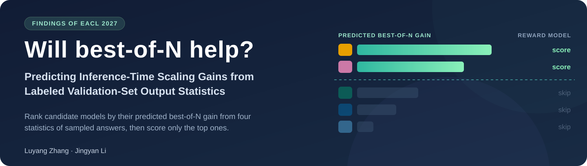
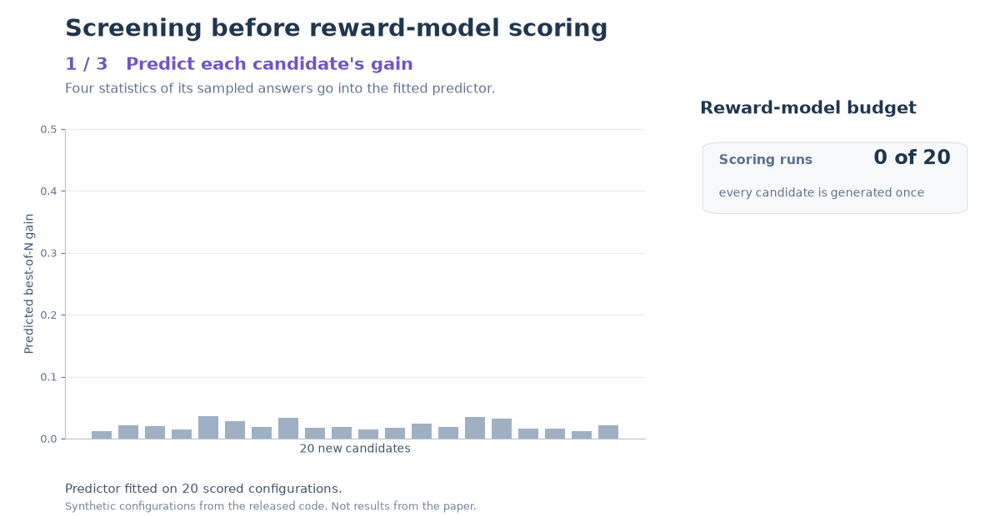
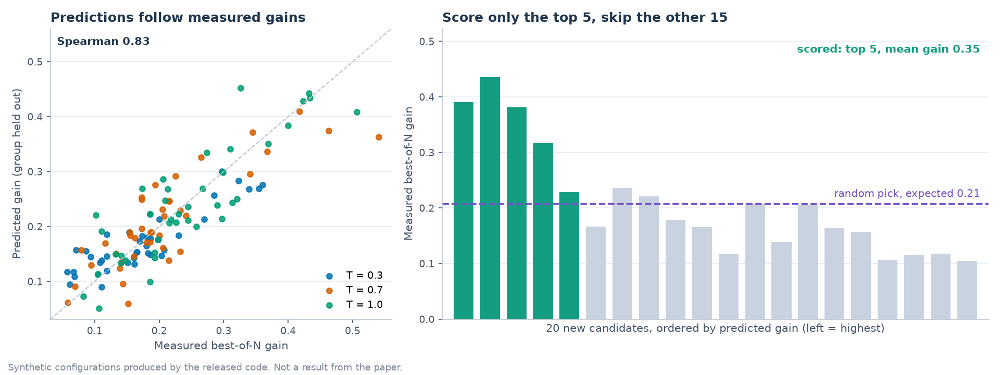
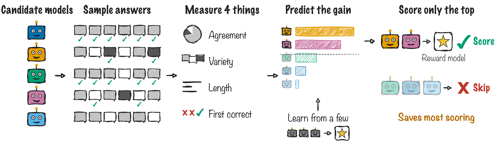

<div align="center">



# Predicting Inference-Time Scaling Gains

### from Labeled Validation-Set Output Statistics

**[Luyang Zhang](https://scholar.google.com/citations?user=lIDmS7oAAAAJ&hl=en) · Jingyan Li**<br>
**Findings of EACL 2027**

[](https://arxiv.org/abs/2606.02981)
[](https://arxiv.org/abs/2606.02981)
[](pyproject.toml)
[](https://github.com/LZhang12345/bon-gain-screening/actions/workflows/tests.yml)
[](LICENSE)

[Paper](https://arxiv.org/abs/2606.02981) · [Quick start](#quick-start) · [How it works](#how-it-works) · [Use it in your code](#use-it-in-your-code) · [Your own models](#screen-your-own-models) · [Documentation](docs/method.md) · [Citation](#citation)

</div>

**Best-of-$N$ draws $N$ answers from a model and keeps the one a reward model scores highest.** How much this helps differs a lot from one model to another, and the only way to know has been to run it: generate the answers, then score every one of them with the reward model.

**This repository predicts that gain from four simple statistics of the sampled answers.** Fit the predictor on a few models that were scored in full, rank the new candidates by predicted gain, and run the reward model only on the top of the list.

## See the screening

<p align="center">
  
</p>

The predictor is fitted on 20 scored configurations and ranks 20 new ones. Only the top 5 go to the reward model. Every number shown comes from the released code on synthetic configurations. It is not a result from the paper.

## Quick start

Python 3.10 or later is required. The package needs only NumPy.

```bash
git clone https://github.com/LZhang12345/bon-gain-screening.git
cd bon-gain-screening
python -m venv .venv
source .venv/bin/activate
python -m pip install -e .
python -m bon_screen demo
```

The demo runs on CPU in a few seconds and downloads nothing:

```text
Held-out ranking (40 configurations, 8 groups, one group held out at a time)
  Spearman between predicted and measured gain: 0.833  (95% interval 0.682 to 0.921)

Screening: fit on 20 scored configurations, rank 20 new ones, score the top 5
  Selection                     Mean measured gain
  Top 5 by predicted gain                    0.351
  Random 5 (expected)                        0.208
  True top 5                                 0.352
  Overlap with the true top 5: 4 of 5
  Reward-model scoring runs: 5 of 20 candidates (15 skipped)
```

<details>
<summary>Static plot of the same example</summary>

<p align="center">
  
</p>

</details>

## How it works

<p align="center">
  
</p>

For a configuration $c$ at sampling temperature $T$, the gain is

$$
g(c, T) = \mathrm{BoN}@k(c, T) - \mathrm{pass}@1(c, T),
$$

the accuracy of the reward model's pick among $k$ candidates minus the mean accuracy of a single candidate. The predictor uses four statistics of the same candidates:

| Statistic | What it measures | Needs labels |
| :--- | :--- | :---: |
| Majority-fraction spread | How much agreement with the most frequent answer varies across prompts | no |
| Median answer entropy | How spread out the answers to a typical prompt are | no |
| Completion-length spread | How much answer length varies within a prompt | no |
| First correct position | How early a correct answer appears among the samples | yes |

A ridge regression with one coefficient per statistic, shared across temperatures, and a temperature term maps them to the gain:

$$
g(c, T) = \boldsymbol\beta^\top \mathbf{x}(c, T) + \gamma\,(T - 0.7) + \varepsilon(c, T).
$$

The penalty is chosen by cross-validation that keeps whole groups of configurations together. See [the method notes](docs/method.md) for the exact definitions.

## Use it in your code

```python
from bon_screen import GainPredictor, bon_gain, compact_features, design_matrix, top_k

prompts = [
    {"completions": ["... \\boxed{7}", "... \\boxed{7}", "... \\boxed{8}"], "correct": [1, 1, 0]},
    {"completions": ["... \\boxed{9}", "... \\boxed{6}", "... \\boxed{9}"], "correct": [1, 0, 1]},
]
features = compact_features(prompts, domain="math")

gain = bon_gain(scores=[[0.2, 0.9, 0.1], [0.7, 0.3, 0.1]], correct=[[1, 1, 0], [1, 0, 1]])

x_scored = design_matrix(scored_features, scored_temperatures)
model = GainPredictor().fit(x_scored, scored_gains, groups=scored_groups)
predicted = model.predict(design_matrix(new_features, new_temperatures))
shortlist = top_k(predicted, k=5)
```

`compact_features` takes the sampled completions for one configuration and temperature. `bon_gain` needs reward-model scores and is only computed for the configurations you score. In the last block, `scored_features` and `new_features` are lists of such feature dictionaries, one per configuration and temperature, with matching lists of temperatures, and `scored_groups` names the base checkpoint and task domain of each scored row. `screen` in `bon_screen.screening` does the fitting, averages predictions over temperatures, and returns the shortlist in one call.

## Screen your own models

```bash
python -m bon_screen features examples/generations.jsonl --domain math
python -m bon_screen screen examples/screening_table.csv --top 3
```

`features` reads one JSON object per prompt with `completions` and `correct`. `screen` reads a CSV with one row per configuration and temperature. Rows with a `gain` value train the predictor, and rows without one are ranked. See [the reproduction notes](docs/reproduction.md) for the input format.

## Results in the paper

The paper evaluates 56 configurations (40 math, 16 code) from three base-model families (Qwen2.5, Llama-3, Gemma-2) and six post-training methods, with Skywork-Reward-Llama-3.1-8B as the reward model and $k = 64$ candidates at three temperatures. It reports:

- Spearman correlation of 0.90 between predicted and measured gains, holding out one base checkpoint and task domain at a time
- 0.897 with a median of 19 scored configurations for fitting, against 0.895 with all 56
- 0.85 on gains measured with a second reward model, ArmoRM, without refitting the predictor fitted on Skywork gains
- 0.78 to 0.94 when each post-training method is held out in turn

The predictor does not transfer to majority-vote gains, and its correlation is negative when the whole code domain is held out. These numbers come from the paper's models and evaluation. This repository provides the method. See [the reproduction notes](docs/reproduction.md) for what is and is not included.

## Repository guide

| Path | Contents |
| :--- | :--- |
| [`src/bon_screen/features.py`](src/bon_screen/features.py) | The four statistics |
| [`src/bon_screen/answers.py`](src/bon_screen/answers.py) | Answer extraction for math and code |
| [`src/bon_screen/gain.py`](src/bon_screen/gain.py) | Best-of-$N$ accuracy, single-sample accuracy, and the gain |
| [`src/bon_screen/predictor.py`](src/bon_screen/predictor.py) | Ridge predictor, grouped penalty choice, held-out evaluation, Spearman correlation |
| [`src/bon_screen/screening.py`](src/bon_screen/screening.py) | Fit on scored configurations and rank new ones |
| [`src/bon_screen/toy.py`](src/bon_screen/toy.py) | Synthetic configurations behind the demo |
| [`examples/`](examples/) | Example inputs for the two commands |
| [`tests/`](tests/) | Tests for the statistics, the gain, the predictor, and the demo |
| [`docs/`](docs/) | Method details and reproduction scope |
| [`scripts/`](scripts/) | Regenerate the plot and the animation |

## Development

```bash
python -m pip install -e '.[dev,plots]'
python -m pytest -q
ruff check .
python scripts/build_readme_assets.py
python scripts/build_method_animation.py
```

CI runs the tests and the demo on CPU.

## Citation

If this code is useful in your work, please cite our paper. The entry below is the arXiv version. We will replace it with the proceedings entry once it is published.

```bibtex
@misc{zhang2026predictinginferencetimescalinggains,
  title={Predicting Inference-Time Scaling Gains from Labeled Validation-Set Output Statistics},
  author={Luyang Zhang and Jingyan Li},
  year={2026},
  eprint={2606.02981},
  archivePrefix={arXiv},
  primaryClass={cs.CL},
  url={https://arxiv.org/abs/2606.02981}
}
```

## License

The code is released under the [MIT License](LICENSE).
